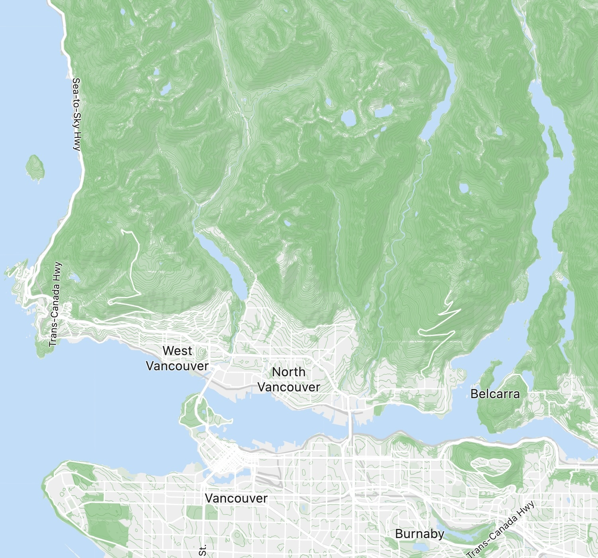

# GeoTIFF workflow and historical benchmarks

This preserves the original GeoTIFF examples and reported benchmarks. They describe the legacy
`default` profile, whose contours use `ele` and `level`. The RBT profile uses `ele`, `index`, and
`is_ice`; see the [current README](../README.md) for Mapterhorn and RBT usage.

## Generate GeoTIFF-based tiles

Install JDK 21 and Maven, then run `mvn package`. For an existing AW3D30 tile directory:

```sh
java -jar target/vectorvector-cli.jar --dataFormat aw3d30 --data data/alos \
  --outputFormat mbtiles --output out/legacy --area pnw
```

Use `--dataFormat srtm` for SRTM GeoTIFF input. Hillshade is enabled by default for these inputs.
`--terrarium` enables elevation PNG output. These paths refer to data you must supply.

## Example



Vector styling included the following for hillshade and contour lines:

<details><summary>(click to expand JSON style)</summary>

```json

{
  "layers": [
    {
      "id": "hillshade",
      "type": "raster",
      "source": "hillshade",
      "source-layer": "hillshade",
      "minzoom": 6,
      "maxzoom": 15,
      "paint": {
        "raster-opacity": [
          "interpolate",
          [
            "linear"
          ],
          [
            "zoom"
          ],
          6,
          0.8,
          11,
          0.4,
          14,
          0.2,
          15,
          0.1
        ]
      }
    },
    {
      "id": "contour_major",
      "type": "line",
      "source": "contour",
      "source-layer": "contours",
      "minzoom": 9,
      "maxzoom": 15,
      "filter": [
        "all",
        [
          ">",
          "ele",
          10
        ],
        [
          "==",
          "level",
          1
        ]
      ],
      "paint": {
        "line-color": "#66bb6a",
        "line-width": {
          "stops": [
            [
              12,
              0.5
            ],
            [
              13,
              1
            ]
          ]
        }
      }
    },
    {
      "id": "contour_medium",
      "type": "line",
      "source": "contour",
      "source-layer": "contours",
      "minzoom": 9,
      "maxzoom": 15,
      "filter": [
        "all",
        [
          ">",
          "ele",
          10
        ],
        [
          "==",
          "level",
          0
        ]
      ],
      "paint": {
        "line-color": "#81c784",
        "line-width": {
          "stops": [
            [
              10,
              0.25
            ],
            [
              11,
              0.5
            ],
            [
              16,
              1
            ]
          ]
        }
      }
    }
  ]
}
```

</details>

The following figures were reported in the original project for its `--area world` GeoTIFF runs
on a different machine. They do not predict the Mapterhorn/RBT planet run or its disk requirements.

## Historical benchmark

Vector contour lines and raster hillshade for the world completed in 6 hours 51 minutes with SRTM source data, and about
14 hours with AW3D30 source data.
The process run on an Apple MacBook Pro with an M2 chip having 12 cores and 64 GB RAM.

| file              | SRTM size | AW3D30 size |
|-------------------|-----------|-------------|
| hillshade.mbtiles | 15.5 GB   | 28.1 GB     |
| vector.mbtiles    | 51.2 GB   | 70.1 GB     |

Command line options:

AW3D30:

```txt
-Xmx42g
--outputFormat mbtiles --data data/alos --dataFormat=aw3d30 --output output --area world
```

SRTM:

```txt
-Xmx42g
--outputFormat mbtiles --data data/tif --dataFormat=srtm --output output --area world
```

Machine spec:

```txt
Model Name: MacBook Pro
Model Identifier: Mac14,5
Chip:	Apple M2 Max
Total Number of Cores: 12 (8 performance and 4 efficiency)
Memory: 64 GB
```

## References

[^1]: **Horn, B. K. P. (1981)**. "Hill shading and the reflectance map." Proceedings of the IEEE, 69(1), 14-47.
https://people.csail.mit.edu/bkph/papers/Hill-Shading.pdf

[^2]: "Marching Squares," *Wikipedia*, https://en.wikipedia.org/wiki/Marching_squares

[^3]: **Kelso, N. V., & Amos, M. (2016, October 11)**. "Mapzen Terrain Tiles are 1.0 and ready to go."
Mapzen. https://mapzen.com/blog/terrain-tile-service

[^4]: **Farr, T. G., et al. (2007)**. *The Shuttle Radar Topography Mission.* Reviews of Geophysics, 45(2).
DOI: [10.1029/2005RG000183](https://doi.org/10.1029/2005RG000183).

[^5]: **Open Geospatial Consortium (OGC)**. "GeoTIFF Standard, Version 1.1." OGC
19-008r4. https://www.ogc.org/standards/geotiff

[^6]: **Ramer, U. (1972)**. "An iterative procedure for the polygonal approximation of plane curves." Computer Graphics
and Image Processing, 1(3), 244–256.
DOI: 10.1016/S0146-664X(72)80017-0

[^7]: **Douglas, D., & Peucker, T. (1973)**. "Algorithms for the reduction of the number of points required to represent
a digitized line or its caricature." The Canadian Cartographer, 10(2), 112–122.
DOI: 10.3138/FM57-6770-U75U-7727

[^8]: ALOS AW3D30 elevation data provided by the Japan Aerospace Exploration Agency (JAXA),
available at 30-meter resolution. Source: JAXA Earth Observation Research
Center. https://www.eorc.jaxa.jp/ALOS/en/dataset/aw3d30/aw3d30_e.htm
